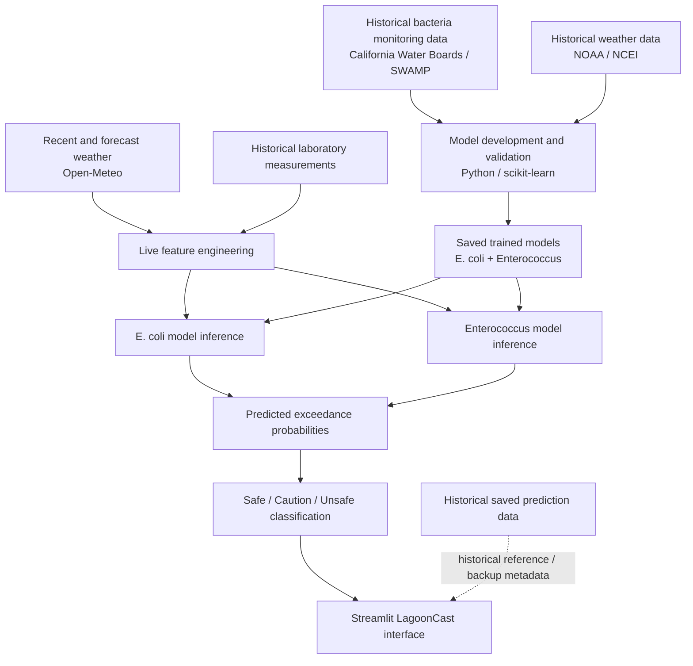

# LagoonCast

**Machine-learning water-quality risk forecasting for Parkside Aquatic Park in San Mateo, California**

LagoonCast is an experimental web application that estimates recreational water-quality risk between laboratory sampling events. It combines historical bacteria monitoring data, recent and forecast weather conditions, engineered environmental features, and trained machine-learning models to estimate the probability that **E. coli** or **Enterococcus** will exceed LagoonCast's model-defined concentration thresholds.

The results are translated into simple **Safe, Caution, or Unsafe** categories for public-facing interpretation.

**Live app:** https://lagooncast.streamlit.app/  
**GitHub:** https://github.com/XL-DSL/LagoonCast

> LagoonCast is an experimental decision-support tool. It does not directly measure current bacteria concentrations and does not replace official laboratory results, beach advisories, or closures.

---

## The Problem

Water-quality monitoring relies on laboratory sampling. At Parkside Aquatic Park, this can leave periods between samples when environmental conditions may change without a new laboratory measurement.

Rainfall, temperature, dry periods, seasonality, and previous bacteria measurements can all contain information related to bacterial risk. LagoonCast uses these relationships to provide a forward-looking estimate during the gap between official samples.

The goal is not to replace laboratory testing. The goal is to make the period between tests more informative.

---

## Intended Users

LagoonCast is designed for people deciding whether to participate in recreational activities at Parkside Aquatic Park, including:

- Families and swimmers
- Kayakers and paddleboarders
- Cleanup volunteers
- Community environmental groups
- Educators and students

The application presents model output in plain language while retaining technical information for users who want to understand how the prediction was produced.

---

## Main Features

### Current Forecast

The homepage presents the current LagoonCast risk estimate for Parkside Aquatic Park, including:

- Overall **Safe / Caution / Unsafe** classification
- E. coli exceedance probability
- Enterococcus exceedance probability
- Forecast date
- Data freshness information
- Interactive site map
- Direct link to official San Mateo County water-quality information

### 15-Day Timeline

The Timeline provides:

- Previous 7 days of reconstructed model estimates
- Today
- Next 7 days of forecasts

Historical values are identified as **reconstructed estimates**, not forecasts that were necessarily generated on those historical dates.

Future estimates use forecast environmental conditions, so uncertainty may increase with forecast horizon.

### Recent Trends

The Recent Trends page shows recent reconstructed model estimates so users can see how predicted bacterial-risk probability has changed over time.

Historical reconstruction uses only information available before the target date to reduce the risk of same-day laboratory-data leakage.

### Interactive Map

The Map page identifies the LagoonCast pilot site at Parkside Aquatic Park and displays:

- Current risk classification
- E. coli probability
- Enterococcus probability
- Forecast date
- Directions
- Google Maps access

### Risk Details

The Risk Details page explains the bacteria-specific components behind the overall LagoonCast classification.

### Model & Data

The Model & Data page describes:

- Data sources
- Selected machine-learning models
- Feature sets
- Evaluation metrics
- Model thresholds
- Data freshness
- Methodology

### Limitations

The Limitations page explains where LagoonCast should and should not be relied upon, including uncertainty associated with environmental forecasting and site-specific model performance.

---

## How LagoonCast Works

LagoonCast's current architecture performs **live model inference**. It is not simply displaying a precomputed spreadsheet.



### Primary Live Forecast Path

The current forecasting path is:

1. Retrieve recent and forecast weather conditions.
2. Construct features using the same definitions used during model training.
3. Combine weather features with available prior laboratory-history features.
4. Validate that every required model feature exists and contains a usable numeric value.
5. Run the saved E. coli and Enterococcus models.
6. Convert predicted exceedance probabilities into public-facing risk categories.
7. Display the results in Streamlit.

If required inputs cannot be constructed, LagoonCast marks the current forecast as unavailable rather than silently replacing missing values with zeros.

Historical saved model output may remain in the repository for reference, but an old saved prediction is **not presented as the current forecast** when live inference fails.
### Primary Live Forecast Path

The current forecasting path is:

1. Retrieve recent and forecast weather conditions.
2. Construct features using the same definitions used during model training.
3. Combine weather features with available prior laboratory-history features.
4. Validate that every required model feature exists and contains a usable numeric value.
5. Run the saved E. coli and Enterococcus models.
6. Convert predicted exceedance probabilities into public-facing risk categories.
7. Display the results in Streamlit.

If required inputs cannot be constructed, LagoonCast marks the current forecast as unavailable rather than silently replacing missing values with zeros.

Historical saved model output may remain in the repository for reference, but an old saved prediction is **not presented as the current forecast** when live inference fails.

---

## Data Sources

### Bacteria Monitoring

Historical fecal-indicator-bacteria observations come from California public water-quality monitoring data, including California Water Boards / SWAMP records.

The two modeled indicators are:

- **E. coli**
- **Enterococcus**

### Historical Weather

Historical weather used during model development comes from NOAA / NCEI daily weather records.

### Live and Forecast Weather

The deployed application retrieves recent and forecast daily weather information from **Open-Meteo** for live feature generation.

### Features

Depending on the target model, features include combinations of:

- Previous-day rainfall
- Multi-day rainfall totals
- Rainfall averages and maximums
- Rainy-day counts
- Rainfall intensity
- Lagged rainfall
- Antecedent dry-period conditions
- Temperature averages and ranges
- Wet-season indicators
- First-flush indicators
- Rainfall-temperature interactions
- Prior bacteria measurements and exceedance history

Tide and sanitary-sewer-overflow variables are not part of the current deployed feature sets.

---

## Feature Timing and Leakage Prevention

Because LagoonCast is a forecasting system, feature timing is important.

For a prediction date **t**:

- `rain_1day` represents rainfall from **t - 1**
- `rain_1day_lag1` represents rainfall from **t - 2**
- `rain_1day_lag2` represents rainfall from **t - 3**
- Rolling rainfall and temperature features are shifted so the target date itself is excluded

For reconstructed historical estimates, LagoonCast uses laboratory observations dated **strictly before** the target date.

These rules help keep deployed feature definitions aligned with model-training definitions and reduce information leakage.

---

## Current Models

The current deployment uses Logistic Regression for both bacteria targets.

| Target | Model | Feature Set | Features | Decision Threshold |
|---|---|---|---:|---:|
| E. coli | Logistic Regression | `expanded_no_tides_live_safe` | 43 | 0.27 |
| Enterococcus | Logistic Regression | `base_no_sso` | 9 | 0.63 |

The E. coli live deployment excludes `days_since_prev_sample` as a predictor because extended gaps in laboratory sampling can place that feature far outside the conditions normally represented during model evaluation.

Laboratory sample age can still be tracked as metadata without allowing it to dominate the predicted probability.

---

## Model Evaluation

The currently selected models were evaluated on a chronological held-out test period from **November 13, 2023 through May 26, 2026**.

| Target | Accuracy | Precision | Recall | F1 | False Negatives |
|---|---:|---:|---:|---:|---:|
| E. coli | 63.1% | 58.3% | 95.5% | 0.724 | 3 |
| Enterococcus | 83.1% | 67.7% | 63.6% | 0.656 | 12 |

For this application, recall is particularly important because a false negative represents an elevated-risk event that the model failed to identify.

Model performance does not guarantee that an individual forecast will be correct.

---

## Risk Classification

LagoonCast predicts the probability that bacteria will exceed its model-defined concentration threshold.

### Model-Defined Concentration Thresholds

- **E. coli:** 235 MPN/100 mL
- **Enterococcus:** 130 MPN/100 mL

These values are used to define LagoonCast's modeling targets. They should not be interpreted as a claim that they are the current official closure criteria for Parkside Aquatic Park.

### Public Display Categories

The application converts probability estimates into three user-facing categories.

#### E. coli

- **Safe:** probability < 10%
- **Caution:** 10% to < 50%
- **Unsafe:** ≥ 50%

#### Enterococcus

- **Safe:** probability < 40%
- **Caution:** 40% to < 85%
- **Unsafe:** ≥ 85%

The overall LagoonCast risk is the more serious of the two bacteria classifications.

These public display boundaries are separate from the binary decision thresholds used for model evaluation.

---

## Why Machine Learning?

Bacterial water quality can be related to several environmental conditions at the same time.

A single rainfall threshold may miss interactions involving:

- Recent rainfall
- Longer-term rainfall accumulation
- Temperature
- Dry periods
- Seasonality
- Previous bacterial conditions

Machine learning provides a way to combine these signals into one estimated probability.

LagoonCast compared multiple modeling approaches during development, including:

- Logistic Regression
- Random Forest
- Gradient Boosting

The currently deployed models are the selected Logistic Regression configurations listed above.

---

## Project Structure

```text
LagoonCast/
│
├── main.py
├── requirements.txt
├── model_manifest.json
├── current_best_model_metrics.csv
│
├── e_coli_current_best_model.joblib
├── e_coli_features.txt
├── enterococcus_current_best_model.joblib
├── enterococcus_features.txt
│
├── data/
│   ├── lagooncast_lab_history.csv
│   └── app_predictions.csv
│
├── pages/
│   ├── 0_Current_Forecast.py
│   ├── 1_Risk_Details.py
│   ├── 2_About.py
│   ├── 3_Disclaimer.py
│   ├── 4_Recent_Trends.py
│   ├── 5_Map.py
│   ├── 6_Model_and_Data.py
│   ├── 7_Limitations.py
│   └── 8_Timeline.py
│
├── utils/
│   ├── live_forecast.py
│   ├── styles.py
│   ├── ui.py
│   └── validation.py
│
├── tests/
│
└── docs/
```

Some internal files and model-version identifiers retain the earlier **AquaCast** project name because they were created during earlier stages of development.

The current public-facing application name is **LagoonCast**.

---

## Running LagoonCast for Evaluation

The source code is publicly viewable so reviewers and evaluators can inspect the implementation of LagoonCast.

The following instructions are provided for project review and evaluation.

### 1. Clone the Repository

```bash
git clone https://github.com/XL-DSL/LagoonCast.git
cd LagoonCast
```

### 2. Create a Virtual Environment

```bash
python -m venv .venv
```

### 3. Activate the Environment

Windows:

```bash
.venv\Scripts\activate
```

macOS / Linux:

```bash
source .venv/bin/activate
```

### 4. Install Dependencies

```bash
pip install -r requirements.txt
```

### 5. Run the Application

```bash
streamlit run main.py
```

These instructions are provided to allow inspection and evaluation of the project. They do not grant permission to redistribute, modify, publish, sublicense, or reuse LagoonCast or its source code.

---

## Validation and Failure Handling

LagoonCast performs checks before presenting a live forecast.

These include:

- Required feature presence
- Numeric feature validity
- Probability range validation
- Risk-category consistency
- Forecast-date validation
- Historical-data timing checks

Missing required model inputs are not silently replaced with physically meaningful values such as zero rainfall or zero bacteria measurements.

If a valid current prediction cannot be generated, LagoonCast displays a neutral **Current forecast unavailable** state and directs users to official water-quality information.

---

## Known Limitations

LagoonCast is an experimental research prototype.

Important limitations include:

- It currently models one pilot site: Parkside Aquatic Park.
- It predicts bacterial exceedance **risk**, not exact bacteria concentration.
- It does not directly measure current water conditions.
- Future weather conditions are themselves forecasts, so uncertainty can increase farther into the forecast horizon.
- Laboratory measurements may be less frequent than weather observations.
- Environmental relationships may change over time.
- Performance differs between E. coli and Enterococcus.
- Enterococcus remains more difficult for the current model to identify consistently.
- The model should not be used as a substitute for official public-health guidance.

Users should always follow official advisories, closures, and laboratory results.

---

## Future Development

Potential next steps include:

- Continued validation using newly collected laboratory samples
- Testing LagoonCast at additional recreational-water sites
- Retraining site-specific models where adequate historical data are available
- Comparing model performance across locations
- Improving uncertainty communication for longer-range forecasts
- Evaluating additional timely environmental predictors
- Working with community organizations or local agencies to evaluate practical usefulness

Expansion to a new site would require checking data availability and validating or retraining the model rather than assuming the Parkside model transfers directly.

## Technology

LagoonCast is primarily built with:

- **Python**
- **Streamlit**
- **pandas**
- **NumPy**
- **scikit-learn**
- **joblib**
- **PyDeck**
- **Altair**
- **Requests**
- **Open-Meteo API**

Model development and evaluation were performed in Python using Google Colab.

---

## AI-Assisted Development

AI tools were used to support parts of the development process, including code debugging, implementation assistance, documentation, and review.

The project concept, environmental research direction, data preparation decisions, model evaluation, application requirements, testing decisions, and final implementation choices remain the responsibility of the project developer.

Additional details are documented in:

```text
docs/ai_tools_disclosure.md
```

---

## Safety Notice

LagoonCast is an experimental decision-support application.

It does **not** directly measure current bacteria concentrations and does **not** replace official laboratory testing, public-health advisories, beach closures, or instructions from government agencies.

Always consult official water-quality information before making recreational-water decisions.

---

## Copyright

**Copyright © 2026 Xiaohan Li. All Rights Reserved.**

LagoonCast and its source code are publicly viewable for demonstration and evaluation purposes.

No license is granted to copy, modify, redistribute, publish, sublicense, or create derivative works from LagoonCast or its source code without prior permission from the copyright holder, except as otherwise permitted by applicable law.

The public availability of this repository should not be interpreted as an open-source license.

---

## Author

**Xiaohan Li**

LagoonCast was developed as a student environmental-data and machine-learning project and submitted to the **2026 Congressional App Challenge**.Fimage
